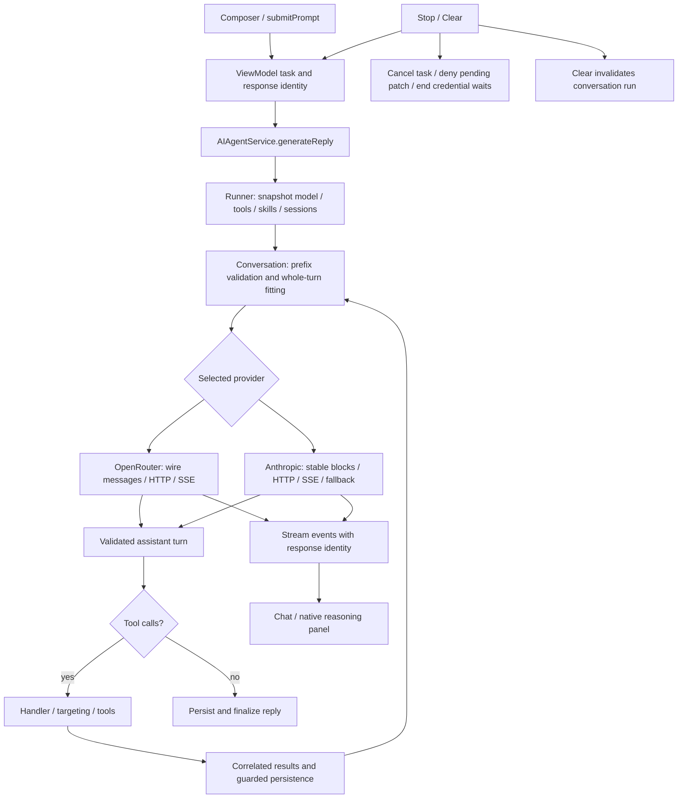

# AI agent audit: service, providers, transcripts and UI

Audit date: 2026-10-18. The primary agent reviewed this area while the three requested
subagents owned tools, execution, and prompts/skills. See the generated
[function inventory](AIAgentFunctionInventory.md) for declarations and source locations.

## Trace

## Review coverage

The inventory covers all 32 `Services/AI/*.swift` files plus the service, three session
integration files, four view models, four terminal views and four settings views (48 files).
It includes explicit initializers/deinitializers, local functions, protocol declarations and
computed properties. Compiler-generated members and unrelated terminal/SSH internals are
excluded. Source inspection and call-path tracing are distinct from executed branch coverage.

| Area | Functions reviewed and behavior followed |
|---|---|
| `AIAgentService` | Protocol conveniences, error messages, model selection, patch policy/callbacks, initializer wiring, conversation clearing, broadcast construction and generation. `AppDependencies` supplies both providers, standard skills, 600-second request timeout and 200 iterations; direct mode caps at 15. |
| `AIAgentRunner` | Initialization/lifetime, full `run` loop, forwarding of six event variants, request timeout race. Followed every exit: missing session/prompt, catalog/request failure, no-tools final reply, tool-result persistence, cancellation, limit exhaustion. |
| `AIConversationContext` | Model reasoning cleanup, prefix validation, budget fitting, whole-turn eviction, append, both reasoning-strip transforms, per-chat storage and clear. New run-token lifecycle prevents cleared/superseded work restoring memory. |
| `AISharedTypes` | URLSession protocol adapters, default provider behaviors, neutral transcript cases and JSON decoding/encoding order. Booleans precede numbers, preserving JSON types. |
| `OpenRouterChatProvider` | Estimation, completion adapter, all three transcript mappings and assistant round-trip with native reasoning. |
| `OpenRouterClient` | Initialization, catalog filtering, authenticated request construction, bounded HTTP body reads, retries, streamed text/reasoning/tool fragments, completion validation, done events, key requirement and error mapping. No actual keys read. |
| `AnthropicChatProvider` | Prefix fingerprint, byte estimation, metadata-driven request, completion/logging, role grouping, native block replay, cross-provider reconstruction and tool-ID mapping. |
| `AnthropicClient` | Initialization, paginated catalog, headers, request JSON, tool schemas, retry delay, streamed blocks/deltas/usage/transformations, fallback assembly, refusal/truncation handling, bounded body reads and error mapping. |
| `ServerSentEvents` | CR/LF/CRLF handling, per-line byte bound, UTF-8 decoding, multiline data events, blank-line dispatch and EOF flush. Both clients exercise it through mocked transport. |
| Provider wire types | OpenRouter factories, reasoning removal, usability/pricing/error properties; Anthropic effort comparison, capability properties, block type/thinking/result helpers, usage merge, stable JSON helpers and errors. |
| Model stores / provider selection | Initialization/cache restore, selected metadata, require/select, context/output limits, effort clamp, refresh/retry state and unchanged-value publishing guard. |
| Keys / settings models | Keychain load/save/delete with data-protection and legacy fallback, provider-specific key trimming, legacy cleanup marker ordering, key-state refresh/save/remove/paste and redacted hints. Reviewed source only; no real Keychain access. |
| `TerminalAIAssistantViewModel` | Submit/task lifecycle, all stream/reasoning handlers, fallback animation/chunking, Stop/Clear, approval continuation lifecycle, result/status messages and credential-publisher mirroring. |
| `TerminalAIAssistantPane` | Submission guards, model/session labels, message filtering/scroll, status/patch cards, sheet binding, composer AppKit bridge and delegate callbacks, key/focus/frame/menu methods, segment/code/table/Markdown rendering and notifications. |
| Native reasoning / approval / credential views | Construction, updates, layout/selection, attributed runs, diff rows and labels/actions. `ReasoningStreamViewTests` exercises actual native text layout. |
| Settings views | Both model pickers, filtering/pricing/limits, key fields, effort/provider bindings, patch toggles and skills-folder action. Reviewed AI wiring in `SettingsView` and `AppDependencies` at their boundary; their unrelated functions are outside scope. |

## Fixed findings

1. **Stale streams after Stop/Clear.** Queued callbacks ran independently of the cancelled
   parent task. Text could mark a stopped reply streaming again; reasoning could contaminate
   the next turn. Each run now has an active response identity, captured before its task
   starts. Every callback and post-suspension finalization checks it.
2. **Fallback animation survives cancellation.** Its sleeps swallowed cancellation and it kept
   appending chunks, then reset `isSending` and the task handle after a new run had started.
   Animation now exits on cancellation/response replacement; outer finalization checks again.
3. **Cleared conversation restored by an old tool result.** Persistence deliberately occurs
   after a complete tool cycle, including when Stop cancels it. Clear previously allowed that
   write to resurrect a removed chat; a superseded run could overwrite newer memory too.
   Per-conversation run identities now guard updates and finish. Clear invalidates the token;
   Stop still keeps completed tool/results. The runner checks identity after suspensions.
4. **Invalid thinking consumes the context budget.** Prefix changes and first-turn eviction
   made Claude's old thinking unusable, but fitting happened before removal. This could evict
   useful messages or reject a turn whose ordinary messages fit. Prefix cleanup now precedes
   sizing; the first eviction strips invalid thinking before fitting the remainder, including
   the current tool loop. Tool/result associations remain whole.
5. **Patch tests depend on saved preferences.** The service's policy read standard defaults
   even when its model store used an isolated suite. The service now accepts injected defaults;
   production retains live settings while agent/contract tests use isolated policy suites.
6. **Cancelled approval entry.** A cancelled task could still open an approval sheet; a second
   request could overwrite its pending continuation. Entry now declines cancelled tasks and
   settles the previous continuation before installing a replacement.
7. **Tool error logging can include file content.** Diff-context errors contain source lines.
   Their log interpolation is now private; correlated tool names, IDs and timings stay public.

Regression evidence: three ViewModel race tests, run-token/context-fitting tests, an actual
runner suspended in a tool while Clear invalidates its chat, and the existing provider/replay,
settings and native rendering suites. The main spec records final executed results.

## Limits and follow-up

- No billable model request, real-key read, remote mutation, or app restart was performed.
  Vendor prompt/credential behavior and dollar/iteration savings still need NetworkCopilot
  Phase 7 runs. The real local-shell fixtures in the coordinator suite cover wrapper behavior,
  but do not prove a complete live assistant workflow.
- Cross-provider tool-ID sanitization can map distinct IDs to the same value. A reversible or
  hashed mapping needs careful native-prefix migration; do not rewrite signed Claude blocks.
- Context budgeting is a conservative UTF-8 estimate, not a provider tokenizer/count endpoint.
  Large tool results in one current turn cannot be evicted; output pagination is still needed.
- A timeout task group depends on the provider cooperating with cancellation. The URLSession
  clients do; an injected provider that never resumes cannot be forcibly unwound.
- SSE lines and non-streamed bodies are bounded, but aggregate event/stream size is not. The
  OpenRouter parser expects the single completion requested by this client; multiple choice
  streams and new provider stop/block types need separate fixtures.
- `AnthropicModelStore.refresh` coalesces concurrent refreshes by returning early. A caller
  entering during another refresh can use cached/default metadata until the refresh finishes.
- `run_cli_command` still polls and normalizes its bounded capture; do not claim a measured
  CPU improvement from this audit. Full-file helper reads and synchronous skill loading are
  additional unmeasured costs recorded by the subagents.
- The historical architecture doc still described per-session memory, timeout escape output,
  and an outdated prompt length; these descriptions are corrected with the integrated result.

The separate [tools](AIAgentAuditTools.md), [execution](AIAgentAuditExecution.md) and
[prompt/skills](AIAgentAuditPrompts.md) reports contain the remaining area-specific risks.
