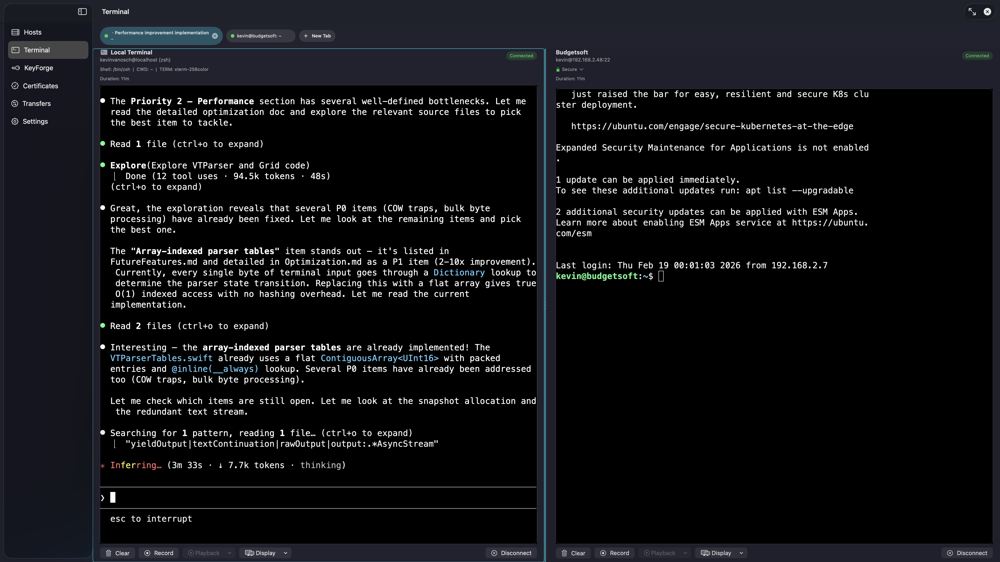

# ProSSHMac

A native macOS SSH client and terminal, built with SwiftUI and Metal. It combines a GPU-rendered terminal, split panes and tabs, an SFTP browser, SSH key and certificate management, and an AI copilot that works inside your sessions. Every file change it proposes is shown as a diff and waits for your approval.




> **Status: 0.9.0, pre-release.** The core is in daily use, and the [known limitations](#known-limitations) are listed openly. Contributions are very welcome. See [Contributing](#contributing).

---

## Highlights

- **An AI copilot that acts, with you in control.** It reads the screen, runs commands, and searches and reads files, locally or over SSH. It can work across all your open sessions at once. File edits arrive as a diff card and only apply after you click Approve.
- **Password prompts stay yours.** When a command the copilot runs stops at a `sudo`, `su` or SSH password prompt, the run pauses and a card appears. You type the password in the terminal, so the model never sees it, and nothing is recorded.
- **Network device CLIs.** On routers and switches, the copilot presses through pagers and waits for the prompt to come back. It also pauses at `enable` password prompts.
- **A built-in SSH certificate authority.** CA keys are generated in the Secure Enclave and signing happens there. Revocation is handled with KRLs.
- **A fast native terminal.** Metal rendering with a glyph atlas draws at the display's refresh rate and only when something changes. A table-driven VT/xterm parser feeds it.

---

## Features

### Terminal

- **Metal rendering**: glyph atlas and cache, demand-driven frames, smooth scrolling, cursor animation
- **VT100/xterm emulation**: table-driven parser for CSI, SGR, OSC (including OSC 133 prompt marks), ESC and DCS (DECRQSS)
- **Tabs, split panes and external windows**: tree-based splits with draggable dividers and saved layouts. Detach a session into its own window, or maximize a pane with `Cmd+Shift+Return`.
- **Broadcast input**: type into every pane, or a selected group of panes (`Cmd+Shift+B`)
- **Local shells**: PTY-backed zsh/bash sessions next to your SSH sessions
- **Keyboard protocols**: kitty keyboard disambiguation and xterm `modifyOtherKeys`, so Shift+Enter works in TUIs. At a plain zsh prompt it inserts a newline.
- **Shell integration**: command blocks and history from OSC 133 marks, with a heuristic fallback. It is automatic for local shells and opt-in per host for SSH.
- **Search** (`Cmd+F`) with regex and case-sensitive matching
- **Session recording**: encrypted on disk, exportable as asciinema `.cast`

### AI Terminal Copilot

Open the sidebar with `Cmd+Option+I`. It works with **OpenRouter** (any tool-capable model from its catalog) or directly with **Anthropic** (Claude). You pick the provider and model in Settings. Each chat keeps its own memory across turns and model switches. Stop cancels the run and keeps the conversation; Clear starts a new one.

| Tool | What it does |
|---|---|
| `get_current_screen` | Read the visible terminal contents |
| `get_recent_commands` / `get_command_output` | Recent commands with exit codes, and the full output of any of them |
| `execute_and_wait` | Run a command and return its output and exit code |
| `execute_command` | Start an interactive or long-running program |
| `send_input` | Type into a running program: answer prompts, send Ctrl+C, drive REPLs |
| `run_cli_command` | Run a command at a router or switch prompt, paging through output |
| `search_filesystem` / `search_file_contents` | Find files by name or content |
| `read_files` | Read up to 10 files in one call |
| `apply_patch` | Edit local or remote files with a V4A diff, applied only after you approve |
| `list_sessions` | List open sessions. Every tool takes a `target_session`, so one chat can work on several hosts. |
| `load_skill` | Load one of your own Markdown skill files (see [Docs/Skills.md](Docs/Skills.md)) |

A request runs up to 200 tool iterations. Prompts that start with `run `, `execute ` or `cd ` use a smaller tool set and stop after 15.

**Device prompts.** Hosts can be tagged with a shell or device type. Prompt patterns ship for zsh, bash, fish, POSIX sh, Cisco IOS/IOS-XE, Juniper JunOS, Arista EOS, MikroTik RouterOS, Palo Alto PAN-OS, HP/Aruba ProCurve, Fortinet FortiOS and Nokia SR OS, or you can supply your own regex. Most device patterns have not yet been tested on real hardware. If you have the gear, that is one of the most useful ways to help.

### SSH and Security

- **Authentication**: password, public key, certificate and keyboard-interactive, plus single-hop jump hosts. TOTP codes can be generated per host.
- **KeyForge**: generate RSA, ECDSA and Ed25519 keys (or Secure Enclave P-256), import and inspect keys, convert between OpenSSH, PEM and PKCS#8, copy public keys, and run `ssh-copy-id`
- **Certificate authority**: sign user and host certificates with a Secure Enclave CA key; KRL revocation
- **Local port forwarding** with a rule editor
- **Host key verification**: trust on first use, with a persistent known-hosts store and a prompt when a key changes
- **Algorithm policy**: modern algorithms first, with legacy algorithms as an opt-in per host
- **Encrypted storage**: AES-256-GCM with a Keychain-held master key; optional Touch ID-protected password and passphrase cache
- **Audit log**: connections, authentication, host verification, security events and port forwards
- **`~/.ssh/config`**: import with a preview, and export, both through the clipboard

### Files

- **File browser sidebar** (`Cmd+B`): a lazy-loading tree, over SFTP for remote sessions and the local filesystem otherwise. Open a file in `nano`, `vim` or `less`, `cat` it, or download it.
- **Transfers** tab with per-transfer progress

### Productivity and appearance

- **Quick Commands** (`Cmd+Shift+P`): snippets with variables, global or per host, JSON import and export
- **Spotlight** search for hosts, and **Shortcuts** actions to open a section or connect to a host
- **Effects**: CRT (scanlines, barrel distortion, phosphor persistence), bloom and text glow, gradient backgrounds, scanner, transparency, bell, and a Matrix idle screensaver
- **Prompt colours** for local shells

---

## Known limitations

These are tracked in [Docs/bugs.md](Docs/bugs.md), and each is a good place to contribute.

- Port forwarding is **local only**: no remote (`-R`) or dynamic/SOCKS (`-D`) forwards yet.
- **Agent forwarding** sends the request, but nothing answers the remote agent channel yet (Bug 98).
- **Secure Enclave user keys** can be generated but **can't be used to log in** yet; that needs an in-app agent (Bug 99).
- Keyboard-interactive auth answers prompts with the stored secret rather than asking you, so password + OTP servers can fail (Bug 100).
- URLs are **not clickable** in the Metal renderer, and OSC 8 hyperlinks are dropped (Bug 102).
- `~/.ssh/config` import reads from the clipboard only, and doesn't follow `Include` (Bug 106).
- Jump hosts support a single hop.

---

## Requirements

- **macOS 26.0** (Tahoe) or later
- To build: **Xcode 27** with the **Metal Toolchain** component installed (`xcodebuild -showComponent metalToolchain`)
- No package manager needed. libssh and OpenSSL are vendored.
- For the AI copilot: an OpenRouter or Anthropic API key

---

## Getting Started

### Install

Download the latest `.dmg` from [Releases](https://github.com/khpbvo/ProSSHMac/releases), open it, and drag **ProSSHMac** into **Applications**.

### Build from source

```bash
git clone https://github.com/khpbvo/ProSSHMac.git
cd ProSSHMac
open ProSSHMac.xcodeproj   # then select the ProSSHMac scheme and press Cmd+R
```

Or from the command line:

```bash
xcodebuild -project ProSSHMac.xcodeproj -scheme ProSSHMac -destination 'platform=macOS' build
```

### Run tests

```bash
# One suite (the usual way while working)
xcodebuild -project ProSSHMac.xcodeproj -scheme ProSSHMac -destination 'platform=macOS' \
  test -only-testing:ProSSHMacTests/<TestClassName>

# Everything (~900 tests; some need the host app)
xcodebuild -project ProSSHMac.xcodeproj -scheme ProSSHMac -destination 'platform=macOS' test
```

### Set up the AI copilot

1. Open **Settings → AI Assistant** and choose a provider: **OpenRouter** or **Anthropic**.
2. Save your API key. It is stored in the macOS Keychain.
3. Choose a model. The OpenRouter list shows only models that support tool calling, with context size and prices.

Optional: **Open Skills Folder** in the same section to add your own Markdown skills.

### Build a DMG

```bash
./scripts/create-dmg.sh          # unsigned, for testing
./scripts/create-dmg.sh --sign   # signed and notarized; needs DEVELOPER_ID_APP, APPLE_ID,
                                 # APPLE_TEAM_ID and APPLE_APP_PASSWORD in the environment
```

The DMG is written to `build/ProSSHMac-<version>.dmg`.

---

## Architecture

SwiftUI with MVVM, dependency injection through `AppDependencies`, and Swift 6 strict concurrency. The app target defaults to `MainActor` isolation. `SessionManager` delegates to seven focused coordinators (shell I/O, rendering, SFTP, AI tools, reconnect, keepalive, recording).

```
ProSSHMac/
├── App/            Entry point, dependency injection, navigation, benchmark runners
├── Models/         Host, Session, SSHKey, SSHCertificate, Transfer, AuditLogEntry, TOTP
├── ViewModels/     Host list, KeyForge, certificates, AI settings, AI assistant
├── UI/             SwiftUI views: Terminal, Hosts, KeyForge, Certificates, Transfers, Settings
├── Services/       Session lifecycle and coordinators, storage, keys, CA, forwarding, PTY
│   ├── SSH/        libssh transport, channels, algorithm policy, credential resolution
│   └── AI/         Agent loop, tools, OpenRouter and Anthropic clients, apply_patch, skills
├── Terminal/
│   ├── Parser/     VT state machine and CSI/OSC/SGR/ESC/DCS handlers
│   ├── Grid/       Cell grid, scrollback, reflow, snapshots
│   ├── Renderer/   Metal pipeline, glyph atlas, shaders, smooth scrolling
│   ├── Input/      Key and mouse encoding, paste, selection
│   ├── Features/   Panes, tabs, search, recording, quick commands, history index
│   ├── Effects/    CRT, bloom, gradients, scanner, screensaver, link detection
│   └── Diagnostics/ Opt-in signposts and stage timers for performance work
├── CLibSSH/        C wrapper around libssh
├── AppIntents/     Shortcuts actions
└── Platform/       Platform shims
```

| Vendored library | Version | License |
|---|---|---|
| [libssh](https://www.libssh.org/) | 0.12.0 | LGPL-2.1 |
| [OpenSSL](https://www.openssl.org/) | 3.4.1 | Apache 2.0 |

Both are universal (arm64 + x86_64) xcframeworks in `Vendor/`.

---

## Roadmap

The full ranked plan, with sizes and dependencies, is [Docs/The big picture(October 2026).md](<Docs/The big picture(October 2026).md>). The near term:

1. **Release readiness**: updated libssh/OpenSSL with a reproducible vendor build, working CI, signed releases with auto-update
2. **SSH agent**: agent forwarding, and Secure Enclave keys that can log in
3. **Keyboard-interactive prompts and MFA** shown to the user
4. **Broadcast completeness**: paste, Quick Commands and drops follow broadcast mode
5. **Clickable links** in the Metal renderer, plus OSC 8
6. **Network workflow**: plain-text session logs, host inventory at scale, vendor profiles as data, serial console, and remote/SOCKS forwarding

Later: AI trust controls (redaction, per-host policy), triggers and highlighting, colour schemes, VoiceOver, iCloud sync, FIDO2 keys, and tmux control mode.

---

## Contributing

Contributions are welcome. That includes Swift and Metal work, and also testing on network gear, reproducing bugs and improving docs. Start with [CONTRIBUTING.md](CONTRIBUTING.md). It explains the plan-first workflow, how to build and test, and what a PR needs.

Good entry points: the [Known limitations](#known-limitations) above, open entries in [Docs/bugs.md](Docs/bugs.md), and issues labelled [`good first issue`](https://github.com/khpbvo/ProSSHMac/labels/good%20first%20issue).

### Scripts

| Script | Purpose |
|---|---|
| `scripts/create-dmg.sh` | Build a DMG (optionally signed and notarized) |
| `scripts/benchmark-throughput.sh` | Terminal throughput: parser only, real PTY, or the full app path with rendering |
| `scripts/benchmark-peer-emulator.sh` | The same workload in Terminal.app and iTerm2 for comparison |
| `scripts/benchmark-ssh.sh` | Raw SSH transport throughput to a host |
| `scripts/take-screenshots.sh` | Launch the app with sample data and capture screenshots |
| `scripts/inventory-ai-functions.py` | Print a Markdown inventory of the AI copilot's Swift declarations |

---

## Security

Please report vulnerabilities privately; see [SECURITY.md](SECURITY.md). Don't open public issues for security reports.

## License

[MIT](LICENSE). Vendored libraries keep their own licenses (LGPL-2.1 for libssh, Apache 2.0 for OpenSSL).
